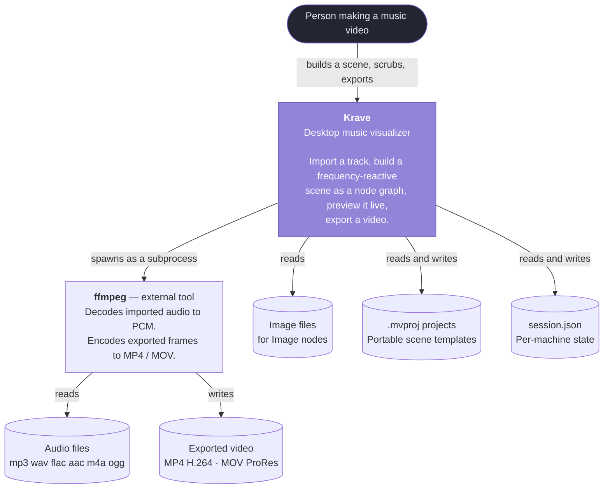

# 1 · Context — Krave in its world

**Sources:** `README.md`, `src/app/main.cpp`, `src/core/AudioBuffer.h`, `src/core/FfmpegLocator.cpp`, `src/app/Session.h`, `src/app/Project.h`

The highest zoom level: Krave as one box, and everything outside it.

---

## What Krave is

A desktop application for making music-visualizer videos — the kind where a row of
frequency-reactive bars dances over a background while a track plays. You import audio,
build the scene as a node graph, watch it react in real time, and export a video file.

It is a **single-user desktop editor**, not a service. There is no network, no account,
no database. Everything it touches is a local file or a local subprocess.

---

## The founding idea

Everything in the architecture follows from one choice:

> **The whole decoded track lives in memory for the session, and the playhead position
> is always known. So spectrum analysis is a pure function of
> `(pcmBuffer, timeSeconds)` — not a tap on a live audio stream.**

Stated at `src/core/AudioBuffer.h:9-14`:

> "The whole track lives here for the lifetime of the session. That is what lets
> spectrum analysis be a pure function of (buffer, time) rather than something driven
> by a live audio tap — preview and export can then ask for the exact same window of
> samples and get the exact same answer."

The consequences reach every corner of the program:

- **Preview** asks for the spectrum at the playback cursor, 60 times a second.
- **Export** asks for the spectrum at `frameIndex / fps`, as fast as the GPU allows.
- Both render **the same `VisualizerCanvas.qml`**, bound to **the same `RenderList`**,
  over **the same `Node` objects**. The exported video therefore cannot drift from what
  you previewed — not because the two paths are carefully kept in sync, but because
  there is only one path.
- Scrubbing is free: seeking is just a different `timeSeconds`.
- Analysis can run on a worker thread, or synchronously on the GUI thread during
  export, with no difference in result.

Two rules keep that promise honest, and both are load-bearing enough to have their own
decision records:

- Smoothing and decay are stored as **time constants**, with the per-frame blend factor
  derived as `1 - exp(-dt / tau)`. A per-frame factor would make a 30 fps export decay
  at half the rate of a 60 Hz preview.
  → [ADR-0010](../decisions/0010-smoothing-is-a-time-constant.md)
- Export installs a **fixed-step `QAnimationDriver`**, so every QML animation advances
  exactly `1/fps` per rendered frame. Rendering runs several times faster than real
  time, so on the wall clock an animation would burn through twelve seconds of motion
  in the two seconds the render actually took.
  → [ADR-0011](../decisions/0011-fixed-step-animation-driver.md)

---

## The people and systems around it

### The user
One person, on one machine, building one video at a time. They are assumed to
understand what a frequency spectrum is but **not** to want to tune an FFT — which is
why all the audio conditioning is gathered onto a single **Separator** node with
"how it should look" controls rather than "what it really is" controls.
→ [ADR-0015](../decisions/0015-linear-amplitude-and-expansion.md)

### ffmpeg — the one hard external dependency
ffmpeg is **both the decoder and the encoder**. Import shells out to it to turn any
supported audio file into 48 kHz stereo `f32le` PCM; export pipes raw RGBA frames into
its stdin. `ffprobe` is used alongside it to get a duration up front for the progress
bar.

Reasoning, from `src/core/AudioDecoder.h:11-15`:

> "Decoding shells out to ffmpeg rather than using a decode library: ffmpeg is already
> a hard dependency for export, and it covers mp3/wav/flac/aac/m4a/ogg with one code
> path and no extra third-party code."

Discovery order is `MV_FFMPEG` environment variable → a `QSettings` key → `PATH`
(`src/core/FfmpegLocator.cpp:42-46`). Without it, import and export are both disabled
and the toolbar says so.

### The filesystem — three distinct kinds of state

This separation is deliberate and is the thing most often gotten wrong by newcomers:

| File | Holds | Portable? |
|---|---|---|
| **`.mvproj`** | The scene: nodes, their properties, their graph positions, the edges between them, and the canvas settings. | **Yes, by design** — it stores **no audio path**. A project is a reusable template. |
| **`session.json`** | What to reopen on launch: last project, last track, playback volume. Lives under the platform config dir (`~/.config/kroma/Krave/` on Linux). | No — it is about *this machine*. |
| **Exported video** | Output. Never read back. | — |

From `src/app/Session.h:9-16`: a `.mvproj` is a portable template, while "the track,
and where the volume was left, belong to this machine's session rather than to the
document." That split is what lets you hand someone a project file without also
handing them your music library.
→ [ADR-0017](../decisions/0017-no-audio-path-in-project.md)

---

## What it deliberately does not do

Knowing the boundary saves time before you start building something that was ruled out:

| Not supported | Why | More |
|---|---|---|
| `multiply` blend mode | Needs the destination as a shader input; Qt Quick's scene graph does not expose it. | [ADR-0012](../decisions/0012-blend-via-premultiplied-alpha.md) |
| Group opacity / group blend | Would need a real offscreen render target per group — the one cost the flat draw list exists to avoid. | [ADR-0013](../decisions/0013-transform-is-identity-blur-is-approximation.md) |
| Blurring two overlapping layers *together* | Convolution does not distribute over a group. You get `blur(A) over blur(B)`. Blur each arm before the Merge instead. | [ADR-0013](../decisions/0013-transform-is-identity-blur-is-approximation.md) |
| Video backgrounds | Not implemented. | — |
| Zoom in the graph editor | Not implemented, but cheap — `content.scale` plus a division in two helpers. | [3 · editor-ui](../3-components/editor-ui.md) |
| Opening pre-v3 project files | Rejected with a message naming `tools/migrate_v2_to_v3.py`. | [ADR-0018](../decisions/0018-no-in-app-migration.md) |
| Any command-line flag | `main.cpp` does no argument parsing at all. See *Known discrepancies* in the [docs index](../README.md#known-discrepancies). | — |

Removed when the layer stack became a graph, and recoverable from git: the **particle
layer** and the background layer's **still image** (the latter now belongs to an Image
node).

---

## Where to go next

- **[2 · Containers](../2-containers/README.md)** — how the one box above splits into
  `mvcore`, `mvapp`, the executable and the ffmpeg subprocess, and the thread model.
- **[decisions/](../decisions/README.md)** — why any of this is the way it is.
