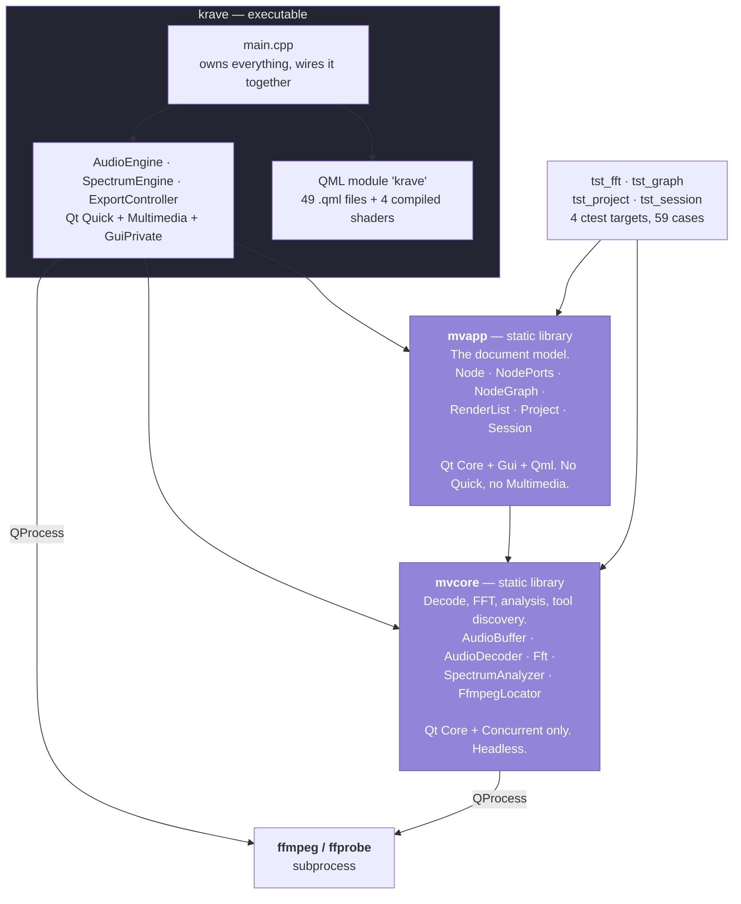
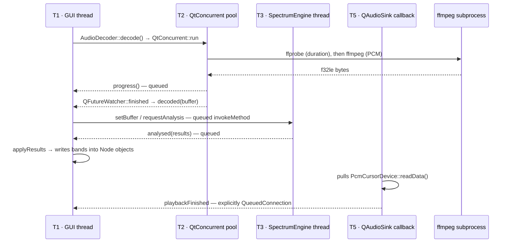

# 2 · Containers — the four units and the thread model

**Sources:** `CMakeLists.txt`, `src/core/CMakeLists.txt`, `src/app/CMakeLists.txt`, `tests/CMakeLists.txt`, `src/app/main.cpp`, `src/core/AudioDecoder.cpp`, `src/app/SpectrumEngine.h`, `src/app/AudioEngine.cpp`

Zooming in one level from [1 · Context](../1-context/README.md): the single Krave box
splits into two static libraries, one executable, and an external subprocess.

---

## The containers

| Container | Links | Why it is separate |
|---|---|---|
| **`mvcore`** | `Qt6::Core`, `Qt6::Concurrent` | No GUI, no QML. Keeps the unit tests fast and headless, and lets the export path reuse the analysis code without pulling in the scene graph. |
| **`mvapp`** | `mvcore`, `Qt6::Core`, `Qt6::Gui` (for `QColor`), `Qt6::Qml` | The document model, extracted in `5b8c714` because `tests/CMakeLists.txt` used to list `../src/app/*.cpp` one by one, "so every split of the model silently dropped a file from the test build". Builds headless. → [ADR-0018 context](../decisions/0018-no-in-app-migration.md) |
| **`krave`** | `mvapp`, `mvcore`, + `Quick`, `QuickControls2`, `Multimedia`, `GuiPrivate` | `main.cpp` and the three engines. They stay **out** of `mvapp` so the library needs neither Quick nor Multimedia — with the consequence that **they have no tests**. |
| **ffmpeg** | — | Both decoder and encoder. Found via `MV_FFMPEG` → `QSettings` → `PATH`. |

`Qt6::GuiPrivate` is an explicit dependency, not an accident: `QRhi` lives behind
private Gui headers and is required by the export path. See
[4 · export-pipeline](../4-code/export-pipeline.md).

### Build-level facts worth knowing before you edit

- The QML module URI is `krave`, and its **root is `qml/`** — each source file is
  aliased to strip the `qml/` prefix (`src/app/CMakeLists.txt:104-107`), so
  `qml/panels/TopBar.qml` resolves as `krave/panels/TopBar`.
- **All 49 `.qml` files are listed explicitly. There is no glob.** Adding a file without
  adding it to `app_qml_files` is the single easiest way to break this build.
- The four singletons (`Theme`, `Icons`, `NodeTypes`, `GraphLayout`) are QML files
  marked `QT_QML_SINGLETON_TYPE TRUE` in CMake plus `pragma Singleton` in the file —
  **not** C++ types.
- Shaders are compiled by `qt_add_shaders` with `PREFIX "/qt/qml/krave"`, deliberately
  matching the QML module's resource prefix so the `.qsb` files sit beside the QML.

---

## How C++ reaches QML

**One mechanism only: `QQmlContext::setContextProperty`.** There is no `QML_ELEMENT`,
no `qmlRegisterType`, and no C++ singleton anywhere in `src/`. Eight names are
registered in `src/app/main.cpp:107-117`:

| QML name | C++ type |
|---|---|
| `audioEngine` | `mv::AudioEngine` |
| `nodeGraph` | `mv::NodeGraph` (a `QAbstractListModel`) |
| `spectrumEngine` | `mv::SpectrumEngine` |
| `project` | `mv::Project` |
| `exportController` | `mv::ExportController` |
| `ffmpegAvailable` | `bool` snapshot |
| `ffmpegPath` | `QString` snapshot (currently unused by QML) |
| `sessionWarning` | `QString`, joined warnings |

`mv::Session` is deliberately **not** exposed — it is a pure C++ collaborator wired up
in `main.cpp`.

Node objects are set to `CppOwnership` (`NodeGraph.cpp:134`) so QML can never garbage
collect one.

> **The `layers/` subtree and `VisualizerCanvas.qml` import no context property at all.**
> They are driven purely by the data handed to them. That self-containment is exactly
> what lets `ExportController` instantiate `VisualizerCanvas.qml` standalone in an
> offscreen window — see [3 · export](../3-components/export.md).

---

## The thread model

This is nowhere written down in the source, and it is the thing most likely to surprise
you.

| # | Thread | Owns | Crosses a boundary by |
|---|---|---|---|
| T1 | **GUI / main** | The engines, `NodeGraph`, every `Node`, `Project`, `Session`, the export render loop | — |
| T2 | **QtConcurrent pool** | The `AudioDecoder` decode lambda | `QFutureWatcher::finished`; `progress()` emitted from T2 and delivered queued |
| T3 | **`SpectrumEngine::m_thread`** | `SpectrumWorker` and its `unordered_map<int, SpectrumAnalyzer>` | queued `invokeMethod` in, `analysed()` out |
| T4 | **Qt Quick render thread** | The preview scene graph | Qt-internal sync against T1 |
| T5 | **`QAudioSink` callback** | Pulls `PcmCursorDevice::readData()` | `playbackFinished` is explicitly `Qt::QueuedConnection` |

Two facts make the whole picture legible:

**There is not one `QMutex`, `std::atomic`, `QSemaphore` or fence anywhere in `src/`.**
All cross-thread coordination is queued signal/slot delivery, `QFutureWatcher`, and the
atomic refcount inside implicitly-shared `QVector`.

**The PCM exists once.** `QVector<float>` is implicitly shared, so the ~115 MB for a
five-minute track is referenced by `AudioEngine::m_buffer`, `PcmCursorDevice`,
`SpectrumEngine`, the worker on T3 and the export worker — and nothing ever writes to it
after decode (`readData` uses `constData()`), so it never detaches.

### Why `playbackFinished` must be queued

`AudioEngine.cpp:99-102` states it:

> "Queued: playbackFinished fires from inside readData(), and stop() tears down the very
> sink and device that are mid-pull. Let the read return first."

### The one unsynchronized access

`PcmCursorDevice::m_cursorFrame` is a plain `qint64` written on T5 inside `readData()`
and read on T1 from `audibleFrame()`. On a 64-bit target the worst case is a stale value
that the surrounding `min()` treats as a ceiling, but it is formally undefined behaviour
and carries no comment. Flagged in
[Known discrepancies](../README.md#known-discrepancies).

### Export runs entirely on T1

`ExportController` calls `SpectrumEngine::renderFrameSync()`, which invokes a **separate**
export worker synchronously on the calling thread. So the export analyzers are touched
only by T1 while the preview analyzers are touched only by T3, and the two sets never
meet. Nothing crosses a thread boundary in the export path.

---

## Where to go next

- **[3 · Components](../3-components/)** — inside each container.
- **[guides/build-and-run](../guides/build-and-run.md)** — actually building it.
- **[4 · qt-quirks](../4-code/qt-quirks.md)** — before you touch any QML.
