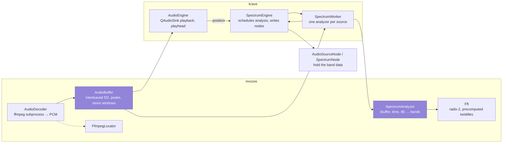
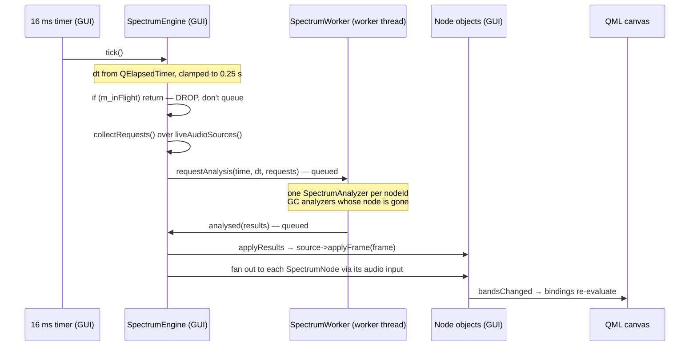

# 3 · Audio and analysis

**Sources:** `src/core/AudioBuffer.*`, `src/core/AudioDecoder.*`, `src/core/Fft.*`, `src/core/SpectrumAnalyzer.*`, `src/core/FfmpegLocator.*`, `src/app/AudioEngine.*`, `src/app/SpectrumEngine.*`

Everything between a file on disk and a number a bar can be drawn from.

---

## Components



---

## Import: file → PCM

```
AudioEngine::importFile(url)                                       [GUI]
  → AudioDecoder::decode(path)
      guards: already busy / file missing / ffmpeg unavailable
      QtConcurrent::run(job)                                       [pool thread]
         ffprobe  -show_entries format=duration      → expected byte count
         ffmpeg   -f f32le -acodec pcm_f32le -ac 2 -ar 48000 -
         drain stdout continuously, emitting progress()
  → decoded(buffer, path)                                          [GUI]
  → AudioEngine::onDecoded: store buffer, computePeaks(2000), rebuildSink()
  → SpectrumEngine::setBuffer(...)                        [GUI → worker, queued]
```

Everything is decoded to **48 kHz stereo `f32le`**, always. Downstream code — including
`SeparatorNode`'s `windowMs → windowSamples` conversion — assumes that rate.

**Draining stdout is mandatory, not defensive**: "Letting the pipe fill would deadlock
ffmpeg."

`progress()` is emitted from the pool thread; the receiver lives on the GUI thread, so
`Qt::AutoConnection` resolves to queued. That is safe and intentional.

### `AudioBuffer`

The class the whole architecture rests on:

> "The whole track lives here for the lifetime of the session. That is what lets spectrum
> analysis be a pure function of (buffer, time) rather than something driven by a live
> audio tap — preview and export can then ask for the exact same window of samples and get
> the exact same answer."

Two behaviours worth knowing:
- **`readMono` writes out-of-range frames as silence**, so an FFT window can be centred on
  *any* timestamp — including the first and last few milliseconds — with no edge case.
  Downmix is a straight average of all channels.
- `computePeaks(2000)` produces the min/max envelope the timeline draws, as 4000
  interleaved values.

---

## Playback

`AudioEngine` drives a `QAudioSink` in **pull mode** over a `PcmCursorDevice`, a tiny
`QIODevice` that memcpys straight out of the shared PCM.

| Detail | Why |
|---|---|
| Sink buffer is **100 ms** | The platform default is around half a second, "which makes seeks feel laggy and leaves a long stale tail" |
| A seek **destroys the sink**, it does not `reset()` it | `reset()` leaves audio already handed to the platform stream, heard as a burst from the old position on the next start |
| The device is **closed and reopened** | So `QIODevice`'s own read buffer goes with it |
| At end of track it feeds **silence**, not a short read | `QAudioSink` treats a short read as an underrun and would stop before the tail is heard |
| `playbackFinished` is **explicitly queued** | It fires from inside `readData()`, and `stop()` tears down the very sink and device that are mid-pull |

### How `position` is derived — the non-obvious part

```
not playing  →  m_playheadFrame                       (authoritative when idle)
playing      →  min(m_startFrame + wallClockElapsed,  m_device->cursorFrame())
```

A **wall clock** anchored at the start of the run, not the sink's byte counters:

> "Audio leaves the device in real time, so a wall clock anchored at the start of the run
> tracks what is being heard. The sink's own byte counters do not: `bytesFree()` reads zero
> immediately after `start()`, which makes the whole buffer look like unplayed audio and
> drags the playhead backwards for the first few hundred milliseconds of every run."

The `min(...)` clamp is "never claim to be past what has actually been read out of the
buffer" — the only thing stopping the playhead running ahead when the sink stalls.

A separate 16 ms timer re-emits `positionChanged` to drive the QML readout. The visualizer
has its own tick.

**`seeked()` is a distinct signal** from `positionChanged`: a jump is not a continuation,
so `main.cpp` wires it to `SpectrumEngine::reset` to drop the smoothing envelopes.

---

## The preview frame path



### Four decisions visible in that diagram

**One analysis per source, not per consumer.** `collectRequests` walks
`NodeGraph::liveAudioSources()` — every `AudioSourceNode` whose `audioRoot()` resolves —
and the results are then **fanned out** along audio edges to the spectrum nodes. Ten
spectrum nodes on one separator cost one FFT.

**Ticks are dropped, never queued.** `m_inFlight` is a plain `bool`, touched only on the
GUI thread. A heavy separator on a slow machine analyses below 60 Hz while the UI stays
responsive, rather than building a backlog.

**`dt` is clamped to 0.25 s.** A stalled GUI thread — a dialog, a file load — would
otherwise deliver a multi-second `dt` and snap every envelope straight to its target.

**Unrendered sources are deliberately not pruned:**

> "Doing so would couple the audio scheduler to the render list and buy a 'my bars froze
> while I was rewiring' bug class for no measurable saving."

### An unconnected spectrum draws nothing

If a `SpectrumNode`'s audio input is empty, `clearFrame()` zeroes it — there is no
fallback to "whichever separator came first".

> "Before the graph it fell back to the first provider in the stack, which was the only
> thing that made the hidden providerId appear to work; now that wiring is explicit and
> visible on screen, that fallback would be guessing. **Honest beats magical.**"

The editor also rings the unconnected required port in warning amber, and `BarLayerView`
splits `hasBands` from `barCount` so zero bands draws **nothing** rather than one bar
filling the layer.

---

## Analyzer ownership

Each consumer owns its own analyzer, so the preview and the export evolve independently.
`SpectrumWorker` keys them by `nodeId` in a `std::unordered_map` — `unordered_map` rather
than `QHash` because `SpectrumAnalyzer` holds a `unique_ptr` and is movable but not
copyable.

**That keying is only safe because node ids are never reused within a session.** Reuse
would let a deleted node's smoothing envelope be inherited by a new node, "which looks
like random flicker rather than like a bug".
→ [ADR-0007](../decisions/0007-node-ids-are-never-reused.md)

A GC pass erases analyzers whose node is no longer live — load-bearing for the same
reason, since without it a deleted node's envelope would linger forever.

Two resets are wired in `main.cpp` for related reasons:
- `AudioEngine::seeked` → `reset()` — a jump must not bleed the old position's spectrum
  into the new one.
- `Project::loaded` → `reset()` — a freshly loaded file restarts ids from *its own*
  numbering, so without this node 3 of the new project inherits node 3 of the old one's
  state for a frame.

---

## Where the traps are

- **`setParams` is called every frame** and must not rebuild. This is the biggest trap in
  the layer → [dsp-pipeline](../4-code/dsp-pipeline.md#the-biggest-trap-setparams-runs-every-frame).
- **`ffmpeg::resolve()` mutates three process globals with no locking** and is reachable
  from the decode thread. Mitigated only by `main.cpp` warming the cache on the GUI thread
  before any decode can start.
- **`SpectrumEngine::frameApplied()` is emitted and has zero consumers.** Either dead code
  or an extension point; nothing says which.
- **`PcmCursorDevice::m_cursorFrame` crosses threads unsynchronized** — see
  [2 · Containers](../2-containers/README.md#the-one-unsynchronized-access).
- **None of this layer's GUI half is tested.** `AudioEngine` and `SpectrumEngine` live in
  the executable, not in `mvapp`. Only `mvcore` — the decoder, FFT, buffer and analyzer —
  has coverage.

---

## See also

- [4 · dsp-pipeline](../4-code/dsp-pipeline.md) — the exact order of operations
- [4 · node-reference § Separator](../4-code/node-reference.md#separatornode--separator)
- [3 · export](export.md) — the same analyzer, driven synchronously
