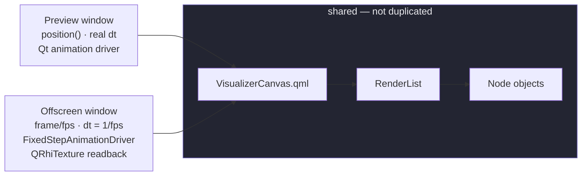

# 3 · Export

**Sources:** `src/app/ExportController.*`, `src/app/qml/panels/ExportDialog.qml`, `src/app/SpectrumEngine.cpp`, `src/app/qml/Main.qml`

Rendering the visualizer offscreen and piping frames to ffmpeg.

---

## The guarantee, and how it is kept

> The export cannot drift from the preview, because **there is only one render path.**

The offscreen window loads the same `VisualizerCanvas.qml`, bound to the same
`RenderList`, over the same `Node` objects. Nothing is duplicated, so nothing can fall out
of sync.



Only three things differ, and each exists for a stated reason:

| Divergence | Why |
|---|---|
| Analysis at `frameIndex / fps` with `dt = 1/fps` | Export renders several times faster than real time |
| A **fixed-step `QAnimationDriver`** | Without it QML animations follow the wall clock and burn twelve seconds of motion in a two-second render → [ADR-0011](../decisions/0011-fixed-step-animation-driver.md) |
| An explicit `QRhiTexture` render target | `QQuickWindow::grabWindow()` returns null under a `QQuickRenderControl` |

And because the analyzer stores smoothing as **time constants**, the two different `dt`
values produce the same decay per unit of *time* — the DSP half of the same promise.
→ [ADR-0010](../decisions/0010-smoothing-is-a-time-constant.md)

---

## The sequence

```mermaid
sequenceDiagram
    participant U as ExportDialog
    participant C as ExportController
    participant S as SpectrumEngine
    participant R as QQuickRenderControl
    participant F as ffmpeg

    U->>C: start(outputUrl)
    C->>C: validate · round w/h to even · clamp fps · totalFrames = ceil(duration × fps)
    C->>S: stop() — and pause playback
    Note over C,S: both would fight the export for the Node band values
    C->>R: buildScene() — same QML, same RenderList, explicit QRhiTexture
    C->>F: start ffmpeg, rawvideo rgba on stdin
    C->>C: install FixedStepAnimationDriver

    loop one frame per event-loop pass (zero-interval timer)
        C->>S: renderFrameSync(t, dt) — synchronous, on the GUI thread
        C->>C: animationDriver->step()
        C->>R: polishItems · beginFrame · sync · render
        R->>C: readBackTexture → endFrame (waits for GPU)
        C->>F: write RGBA bytes
        Note over C,F: pause if bytesToWrite ≥ 32 MiB; resume under 16 MiB
    end

    C->>F: closeWriteChannel → ffmpeg finalizes the container
    C->>S: restore the spectrum tick if it was running
```

**Nothing crosses a thread boundary in the export path.** `renderFrameSync` runs a
*separate* export worker synchronously on the GUI thread, so the export analyzers are
touched only by that thread while the preview analyzers are touched only by the worker
thread. The two sets never meet.

---

## Why playback and the preview tick are stopped

All three — preview analysis, playback, and the export — write the **same `Node`
objects**. Two of them running during an export would overwrite the band values the
export is about to render.

`m_spectrumWasRunning` is remembered at `start()` and restored in `finish()`.

Separately, two live scene graphs iterate one `RenderList`, so a topology change during an
export would `beginResetModel` a model two `Repeater`s are walking. Guarded twice: the
dialog is modal, **and** `Main.qml` disables the graph panel on
`exportController.exporting`.

> Any future path that can mutate graph topology — a global shortcut, an undo stack, a
> file watcher — must be guarded the same way.

---

## Pacing and backpressure

Frames are produced by a **zero-interval repeating timer**: one frame per event-loop pass,
so the UI keeps repainting and progress keeps updating.

Rendering reaches roughly 280 fps; the encoder does not. A two-level hysteresis around
32 MiB of pending writes (≈ four 1080p frames) suspends and resumes the loop, because
otherwise queued 8 MB frames would balloon memory.

> **Known failure mode.** If ffmpeg wedges past the high-water mark, only
> `QProcess::bytesWritten` clears the pause, and there is no watchdog. The symptom is a
> frozen progress bar with no error until the user cancels.

---

## Output

| Codec | Container | Video | Audio |
|---|---|---|---|
| `h264` | `.mp4` | `libx264 -preset medium -crf {quality} -pix_fmt yuv420p` | `aac -b:a 320k` |
| `prores` | `.mov` | `prores_ks -profile:v 3 -pix_fmt yuv422p10le` | `pcm_s16le` |

`yuv420p` because "some players and most hardware decoders will not touch 4:4:4 H.264".
`-shortest` because the frame count and the audio length can differ by a fraction of a
frame.

**The muxed audio is the original file**, decoded a second time by ffmpeg — not the 48 kHz
f32 PCM that drove the analysis.

Full argument list in [4 · export-pipeline](../4-code/export-pipeline.md#ffmpeg-arguments).

---

## Failure and cancellation

- Progress, frames done, and an **ETA** (only after 0.25 s of wall clock, so the first
  estimate is not nonsense) are exposed to the dialog.
- `cancel()` sets an error and finishes; the destructor cancels if still running.
- On failure the partial output file is **removed** — "never leave a half-written file
  behind pretending to be a finished export".
- On success stdin is closed so ffmpeg flushes and finalizes the container, then up to two
  minutes are allowed for it to exit.

---

## Where the traps are

- **`grabWindow()` does not work here.** Anyone "simplifying" the explicit texture path
  back to it gets null images.
- **`start()` mutates `width`/`height`/`fps` without emitting `settingsChanged`**, so an
  odd width is silently rounded for the render while the dialog still shows the odd value.
- **There are no tests.** `ExportController` lives in the executable, not in `mvapp`, so
  no test target links it — and the `--render --cancel-after N` harness that once provided
  regression coverage was deleted along with all CLI parsing. See
  [Known discrepancies](../README.md#known-discrepancies).

---

## See also

- [4 · export-pipeline](../4-code/export-pipeline.md) — the RHI setup, ffmpeg args, backpressure
- [3 · rendering](rendering.md) — what is being rendered
- [4 · dsp-pipeline](../4-code/dsp-pipeline.md) — why `dt` matters
