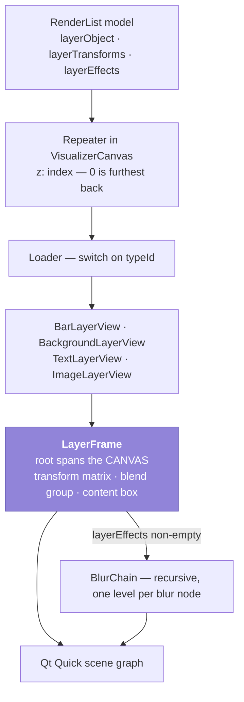
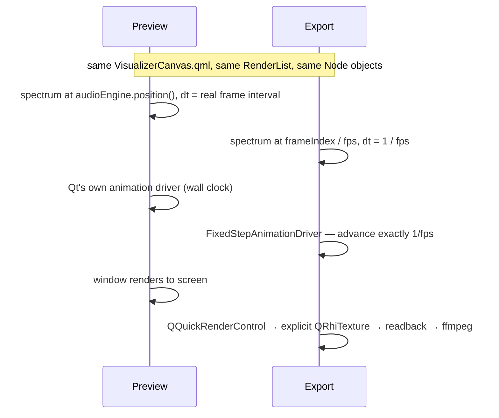

# 3 · Rendering

**Sources:** `src/app/qml/VisualizerCanvas.qml`, `src/app/qml/layers/*.qml`, `src/app/shaders/*.frag`, `src/app/RenderList.cpp`

How an ordered list of nodes becomes a composited frame — identically in the preview and
in the export.

---

## The chain



`VisualizerCanvas.qml` is **self-contained**: it imports neither `krave` nor any context
property, and is driven purely by the data handed to it. That is exactly what lets
`ExportController` instantiate it standalone in an offscreen window.

Type dispatch is a `switch (layerObject.typeId)` over four components, with
`default: return null` — only visual nodes reach a render list at all, so there is nothing
to do for audio, separator, merge, transform, blur or output.

---

## `LayerFrame` — the one abstraction to understand

All four layer views *are* `LayerFrame`s. Its structure is forced by a Qt behaviour:

> **A `Loader` always overwrites its item's `width` and `height`.** Any size binding on
> the loaded item's root is silently clobbered.

So **`LayerFrame`'s root spans the whole canvas** and places the actual layer in an inner
box. This is why `frame.width` / `frame.height` mean *the canvas*, not the layer — the
single most confusing thing about reading `layers/` until you know it.

```
LayerFrame (canvas-sized)
  transform: Matrix4x4 ← folded from layerTransforms
  └── group            ← visible / opacity; layer.enabled only for add|screen
       ├── effectsLoader → BlurChain   (only when layerEffects is non-empty)
       ├── canvasArea    → parent: frame.contentHost   z:0
       └── box           → parent: frame.contentHost   z:1   placed and rotated
```

`canvasArea` and `box` set `parent: frame.contentHost` as a **binding**, so they reparent
into and out of the blur chain with no imperative code.

---

## Normalized geometry → pixels

The rule: **all node geometry is 0..1; multiply by `frame.width` / `frame.height`.**

| Quantity | Mapping |
|---|---|
| Layer box | `box.width = sizeW × frame.width`; `box.x = (posX - sizeW/2) × frame.width` — `posX`/`posY` are **centres**, hence the `- size/2` |
| Text size | `fontScale × frame.height` — a fraction of canvas height, not of the layer box |
| Blur radii, chroma radius, separation | fractions of canvas **height**, converted to pixels in QML before reaching the shader |
| Mask circle | fraction of height, with the aspect correction done **in the shader**, so it stays circular at any aspect |

That is what makes a project render identically at 640×360 preview and 4K export.
→ [ADR-0019](../decisions/0019-normalized-geometry.md)

---

## Transforms

`layerTransforms` is the stack of enclosing `TransformNode`s, **outermost first**.
`composedMatrix()` folds them into one `Matrix4x4`, per transform:

```
translate(offset × canvas) · translate(pivot) · rotate(z) · scale · translate(-pivot)
```

with the offset applied outside the rotate/scale so it reads as a plain screen nudge.

**The matrix goes on the root item, not on `group`** — two reasons: the blend texture must
be captured *before* the transform (a rotated layer must blend with what is beneath it,
not blend a rotated texture), and it must also cover `canvasArea`.

The draw list stays **flat** under transforms because an affine map about a canvas-space
pivot distributes over a group — transforming each member equals transforming the group.
That exactness is why there is no group opacity and no group blend.
→ [ADR-0013](../decisions/0013-transform-is-identity-blur-is-approximation.md)

---

## Blend modes

Qt Quick has no per-item blend mode. `LayerFrame` puts the subtree in `group`, sets
`layer.enabled` **only** for `add` and `screen` (so `normal` costs no offscreen buffer),
and attaches a `ShaderEffect` that abuses premultiplied source-over:

| Mode | Shader output | Compositor result |
|---|---|---|
| `add` | `vec4(rgb, 0.0)` | `dst = src + dst` — exactly additive |
| `screen` | `vec4(rgb, max(r,g,b))` | `dst = src + (1 - max(src)) · dst` — approximate Screen |

`multiply` needs the destination as a shader input, which the scene graph does not
expose, so it is not offered at all.
→ [ADR-0012](../decisions/0012-blend-via-premultiplied-alpha.md) ·
[4 · shaders](../4-code/shaders.md)

> `group` is **canvas-sized**, not box-sized. A `layer.enabled` texture clips to its item,
> so a box-sized group would cut off anything drawn outside the layer box.

---

## The blur chain

`layerEffects` is the stack of enclosing `BlurNode`s, outermost first. `BlurChain`
recurses one level per node — through `Loader { source: "BlurChain.qml" }`, because a QML
file cannot instantiate itself by type name.

```
blurV    (layer.effect = BlurPass dir=(0,1))
└ blurH  (layer.effect = BlurPass dir=(1,0))
  └ split (layer.effect = chroma_split)
    └ next level, or the content hole
```

**Nesting rather than sequencing**, because `layer.enabled` renders a subtree to one
texture for one `ShaderEffect`; a second pass must be a second wrapping `Item`. The chroma
split sits *inside* the blur so its fringe is softened along with everything else. Each
`layer.enabled` is individually gated, so a disabled effect costs no buffer and an all-off
blur node is free. Two blur nodes on one path **nest** rather than conflict.

### The honest caveat

**Blur is applied per layer, not per group** — and unlike transform, that is an
approximation rather than an identity. An affine map distributes over a group; a
convolution does not. So two overlapping upstream layers give `blur(A) over blur(B)`
rather than `blur(A over B)`.

Where it shows:
- Overlapping upstream layers keep crisp edges *against each other*.
- A flat **Background** upstream stays looking sharp, since blurring a solid colour
  returns the same solid colour.

To smear two layers *together*, put a blur on each arm **before** the Merge.
→ [ADR-0013](../decisions/0013-transform-is-identity-blur-is-approximation.md)

---

## Preview and export, side by side

The two paths differ in exactly three places. Everything else — the QML file, the model,
the `Node` objects — is shared.



| Divergence | Why |
|---|---|
| Analysis timestamp and `dt` | Export renders faster than real time |
| Fixed-step animation driver | Otherwise QML animations follow the wall clock and burn twelve seconds of motion in a two-second render → [ADR-0011](../decisions/0011-fixed-step-animation-driver.md) |
| Explicit render target | `grabWindow()` returns null under a `QQuickRenderControl` |

And the analyzer's smoothing is stored as **time constants**, so the two `dt` values give
the same decay per unit of *time*.
→ [ADR-0010](../decisions/0010-smoothing-is-a-time-constant.md)

---

## Where the traps are

- **Never name a property or role `layer`** — `QQuickItem::layer` is `FINAL`. Hence
  `layerObject` and `layerData`.
- **`frame.width` is the canvas, not the layer.** See above.
- **Zero bands must draw nothing.** `BarLayerView` splits `hasBands` from `barCount`:
  `barCount` stays clamped to ≥ 1 for the geometry maths that divides by it, but
  `hasBands` decides whether anything is drawn. Clamping alone turned an unconnected
  spectrum into one bar filling the layer — "a worse answer than the old silent fallback".
- **`inactiveEdgeBars` must be honoured** in both the linear and radial paths, or the
  unresolvable low bands merge into one wide slab at each edge.
  → [ADR-0016](../decisions/0016-unresolvable-bands-are-flagged.md)
- **Do not reach for `Theme` in a layer view.** The `layers/` subtree is deliberately
  import-free so the exporter can instantiate it standalone.

---

## See also

- [4 · render-list](../4-code/render-list.md) — where the ordered list comes from
- [4 · shaders](../4-code/shaders.md) — the maths in each pass
- [4 · qt-quirks](../4-code/qt-quirks.md) — the constraints behind `LayerFrame`'s shape
- [3 · export](export.md)
