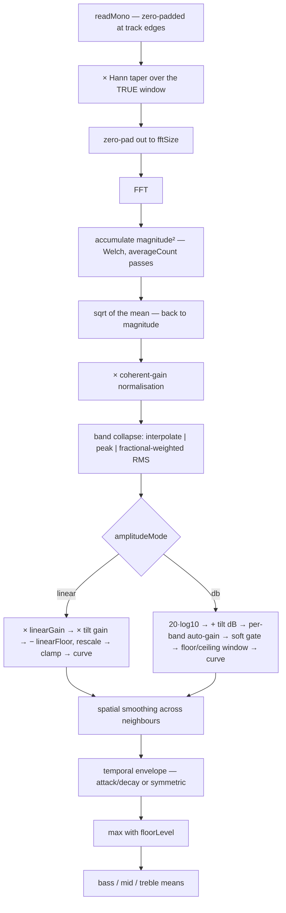

# 4 · The DSP pipeline

**Sources:** `src/core/SpectrumAnalyzer.h`, `src/core/SpectrumAnalyzer.cpp`, `src/core/Fft.cpp`, `src/core/AudioBuffer.cpp`, `src/app/Node.cpp`

The order of operations **is** the behaviour, and no reader can infer it from the
property list. This page states it exactly as the code performs it.

> The root `README.md` summarises this as "Hann window → log bands → dB → time-constant
> smoothing". That is four of about twelve stages and omits Linear amplitude mode
> entirely. Trust this page.

---

## The contract

`SpectrumAnalyzer::analyze(buffer, timeSeconds, dt)` turns `(PCM, time)` into
normalized bands. It is a **pure function of its inputs except for the smoothing
envelope and the auto-gain reference**, which are the only state carried between calls.

Each consumer owns its own analyzer, so the live preview and the export evolve
independently and neither can perturb the other. Pass the real frame interval as `dt`:
`1/60` for preview, `1/fps` for export.

---

## Setup — runs once, or on a structural change

| Step | Where | What |
|---|---|---|
| 1 | `analyze():188-191` | `if (m_dirty) rebuild();` then `if (sampleRate != m_builtForRate) layoutBands(sampleRate);` |
| 2 | `rebuild():79` | `m_windowLen = windowSamples`; `m_fftSize = nextPowerOfTwo(windowLen × padFactor)`; new `Fft(m_fftSize)`; Hann coefficients computed over the **true window only**; `m_frame.assign(m_fftSize, 0.0f)` |
| 3 | `layoutBands():112` | Band edges, per-band gains, `m_activeFrom` |

**The zero padding is written once and must never be disturbed.** `rebuild()` zeroes the
whole `m_frame` buffer; `analyze` then only ever writes `[0, m_windowLen)`. Any future
code that writes past `m_windowLen`, or resizes `m_frame`, silently destroys the
continuous-resolution property.
→ [ADR-0014](../decisions/0014-zero-pad-the-analysis-window.md)

### Band layout (`layoutBands`, `:112-182`)

- `binsPerHz = fftSize / sampleRate`.
- Log endpoints are clamped to ≥ 1e-3 **because `minHz` may be negative** and `log` is
  undefined there (`:125-128`).
- Each band edge blends the two spacings: `edgeHz(t) = logHz × (1-k) + linHz × k`, where
  `k = hzLinearFactor`.
- Bin edges are **fractional**, clamped to `[1, bins-1]` — so **bin 0 (DC) is excluded**.
  Integer edges would make neighbouring bands cover one or two bins alternately and
  stamp a fixed comb across the display.
- `m_bandGainDb[b] = tiltDbPerOctave × octaves + 20·log10(lowFreqRamp)` — the tilt and
  the low-frequency ramp are **precomputed here**, not applied per frame.
- `m_activeFrom` = the first band whose upper edge exceeds 1.0, i.e. the first band that
  maps to a distinct bin. Everything below it is duplicates.

---

## Per frame — the exact chain



### 1 · Read and window (`:211-233`)

`passes = max(1, averageCount)`, `hop = windowLen / 2`. For each pass the window is
offset by `(p - (passes-1)/2) × hop`, so the set of windows is **centred on the
requested timestamp**.

`AudioBuffer::readMono` writes frames outside the track as **silence**, which is what
lets an FFT window centre on any timestamp — including the first and last few
milliseconds — with no edge case.

Then `m_frame[i] *= m_window[i]` for `i < windowLen` only. The padding tail stays zero.

### 2 · Transform and average (`:229-237`)

`m_fft->magnitudes(...)` over the full padded size; `m_power[i] += mag²`. After all
passes, `m_magnitudes[i] = sqrt(m_power[i] / passes)` — averaged in the **power** domain,
then back to magnitude.

Averaging several half-overlapped windows is Welch's method. A single FFT is a
high-variance estimate and the floor between partials looks like grass.

### 3 · Normalise (`:243`)

```
norm = 2.0f / (windowLen * 0.5f)
```

2 for the one-sided spectrum; `windowLen × 0.5` is the coherent gain of the Hann taper
over the **true** window — so changing `padFactor` does not shift the amplitude scale.

### 4 · Band collapse (`:248-281`)

Three mutually exclusive cases per band:

| Condition | Method |
|---|---|
| band narrower than one bin (`hi - lo < 1.0`) | **linear interpolation between the two neighbouring bins at the band centre** — snapping to whole bins here is what produces a fixed comb |
| `measure == Peak` | `max` over the covered bins |
| otherwise (**Rms**, the default) | energy average with **fractional end-bin weights**, then `sqrt` |

### 5a · Linear amplitude mode (`:283-311`)

```
v = amplitude × norm × linearGain
v = v × 10^(bandGainDb / 20)        ← tilt + low-freq ramp, applied as a GAIN
v = (v - linearFloor) / (1 - linearFloor)
v = clamp(v, 0, 1)
v = curve(v)                        ← linear | log10(1+9v) | pow(v, gamma)
```

**No dB window, no auto-gain, no gate.** Quiet content simply stays near zero, which is
what leaves a flat floor with sharp peaks standing on it.
→ [ADR-0015](../decisions/0015-linear-amplitude-and-expansion.md)

### 5b · Decibel mode (`:313-352`)

```
db  = 20·log10(amplitude × norm + 1e-12)
db += bandGainDb                     ← tilt + low-freq ramp, applied in dB

if bandNormalization > 0:            ← per-band auto-gain
    ref += (db - ref) × blendFactor(normalizationTau, dt)
    target     = ceilingDb - 0.35 × span
    normalized = db - ref + target
    db += (normalized - db) × bandNormalization

if gateDb > 0:                       ← soft gate
    gate  = clamp((db - floorDb) / gateDb, 0, 1)
    gate *= gate

v = clamp((db - floorDb) / (ceilingDb - floorDb), 0, 1) × gate
v = curve(v)
```

The auto-gain reference is each band's own slow-moving **average**, deliberately not its
recent peak — a peak reference pins every band at its maximum and flattens dynamics
completely, which measured as a punch ratio of exactly 1.0.

### 6 · Spatial smoothing (`:357-366`)

Only if `spatialSmoothing > 0` **and** `bandCount > 2`. One pass:

```
raw[b] = (1-s)·scratch[b] + s·0.5·(scratch[b-1] + scratch[b+1])
```

edges clamped. Turns a comb of unrelated spikes into one moving contour.

> The scratch buffer is a `static thread_local QVector<float>` shared by every analyzer
> on the thread. Safe — it is reassigned at the top of every use and `analyze()` is never
> re-entrant — but it means the analyzer is thread-*compatible*, not fully
> self-contained.

### 7 · Temporal envelope (`:368-379`)

```
k = symmetric ? blendFactor(smoothTau, dt)
              : (target > smoothed[b] ? attackK : decayK)
smoothed[b] += (target - smoothed[b]) × k
out[b] = max(clamp(smoothed[b], 0, 1), floorLevel)
```

where

```
blendFactor(tau, dt) = 1 - exp(-dt / tau)      (returns 1.0 for tau <= 0)
```

**This derivation from `dt` is the single line that makes a 30 fps export look like a
60 Hz preview.** → [ADR-0010](../decisions/0010-smoothing-is-a-time-constant.md)

### 8 · Aggregates (`:381-398`)

`bass` / `mid` / `treble` are means of the **already-smoothed output** bands, bucketed by
band centre frequency: `< 250 Hz`, `< 2000 Hz`, else treble. Empty buckets yield 0.0.
Those two boundaries are hard-coded.

---

## `SeparatorNode` property → `SpectrumParams` field

`Node.cpp:174-218` is the only real producer of `SpectrumParams`.

| Node property | Params field | Conversion |
|---|---|---|
| `windowMs` | `windowSamples` | `lround(windowMs × 0.001 × 48000)` — **48 kHz hard-coded** |
| `bandCount` | `bandCount` | `max(1, ·)` |
| `minHz` / `maxHz` | same | direct |
| `hzLinearFactor` | same | direct |
| `averageCount` | same | direct |
| `bandMeasure` | `measure` | `"peak"` → `Peak`, else `Rms` |
| `amplitudeMode` | `amplitude` | `"linear"` → `Linear`, else `Decibel` |
| `linearGain`, `linearFloor`, `lowFreqMagnitude` | same | direct |
| `tiltDbPerOctave`, `bandNormalization`, `normalizationTau` | same | direct |
| `floorDb`, `ceilingDb`, `gateDb` | same | direct |
| `scalingCurve` | `curve` | `"log"` → `Logarithmic`, `"linear"` → `Linear`, else `Power` |
| `gamma` | same | direct; `max(0.01, ·)` at use |
| `smoothingMode` | `smoothing` | `"symmetric"` → `Symmetric`, else `AttackDecay` |
| `attackMs` / `decayMs` / `smoothMs` | `attackTau` / `decayTau` / `smoothTau` | `max(0, ms) / 1000` |
| `spatialSmoothing`, `floorLevel` | same | direct |
| — | `padFactor` | **not exposed**; fixed at 2 |

The 48 kHz constant is harmless today because `AudioDecoder` always resamples to 48 kHz,
but it is a hidden coupling between `mvapp` and `mvcore`'s decode constants.
`Node.cpp:177-180`: "48 kHz is assumed here only to convert the duration; the band
layout uses the real rate."

`AudioNode::analysisParams()` (`Node.cpp:144-157`) is a deliberately minimal override:
one band, 20 Hz–20 kHz, Decibel, `attackTau 0.01`, `decayTau 0.15`, auto-gain off.

---

## The biggest trap: `setParams` runs every frame

`SpectrumEngine` re-sends the full parameter struct on **every tick**. So
`setParams` must distinguish "the buffers need rebuilding" from "a value changed"
(`SpectrumAnalyzer.cpp:52-70`):

| Class | Triggered by | Effect |
|---|---|---|
| **structural** | `windowSamples`, `padFactor`, `bandCount` | `m_dirty = true` → full `rebuild()` |
| **relayout** | structural, plus `minHz`, `maxHz`, `tiltDbPerOctave` | `m_builtForRate = 0` → `layoutBands()` re-runs |
| **plain** | everything else | applied with no state loss |

From the header:

> "Rebuilding unconditionally would clear the smoothing envelope and the auto-gain
> reference every frame, which silently turns attack/decay into a plain gain and
> prevents auto-gain from ever converging."

There is no error and the picture still looks plausible — which is why
`tst_fft::analyzerKeepsStateWhenParamsAreResent` exists, and why it also asserts the
envelope is *still falling*, so the comparison cannot pass on two equally-broken runs.

> **Apparent bug.** `lowFreqMagnitude` is folded into `m_bandGainDb` by `layoutBands()`,
> but it is **not** in the relayout trigger set. Changing it alone appears to do nothing
> until some other relayout fires.

---

## Other things that will surprise you

- **`minHz` may be negative**, and that is a supported authoring idiom — it insets the
  lowest audible band from the display edge. The cost is a run of duplicate bands at the
  edge, reported as `SpectrumFrame::activeFrom`.
  → [ADR-0016](../decisions/0016-unresolvable-bands-are-flagged.md)
- **Bin 0 (DC) is never used**, because band edges are clamped to ≥ 1.
- **`reset()` does not rebuild or relayout** — it only zeroes the envelope and reseeds
  the auto-gain reference to `floorDb`.
- **`Fft(size)` silently degrades to size 2** for a non-power-of-two argument
  (`Fft.cpp:17`). `SpectrumAnalyzer` always passes a power of two, so it never fires —
  but a direct `Fft` user gets garbage with no diagnostic.
- **Zero-padding does not improve resolution.** It places more bins under the same peak
  so the per-band interpolation can locate it smoothly. Raising `padFactor` buys CPU cost
  and nothing else.
- **`Fft::magnitudes` applies no scaling** — a unit impulse gives 1.0 in every bin. All
  normalisation happens in the analyzer.

---

## Tests that pin this

| Test | Protects |
|---|---|
| `analyzerSmoothingIsFrameRateIndependent` | decaying 0.5 s at 30 fps and 60 fps agree within 0.02 |
| `analyzerKeepsStateWhenParamsAreResent` | `setParams` does not clear state every frame |
| `windowLengthSetsResolutionContinuously` | a window between two powers of two gives a width between them |
| `unresolvableLowBandsAreFlagged` | `activeFrom` reports the collapsed edge bands |
| `analyzerFindsToneInRightBand` | band mapping is correct |
| `bandNormalizationFlattensWithoutCrushingDynamics` | auto-gain lifts quiet bands without pinning them |
| `matchesNaiveDft`, `sineLandsInOneBin`, `impulseGivesFlatSpectrum` | the transform itself |
| `bufferReadMonoPadsEdges` | out-of-range frames read as silence |

---

## See also

- [node-reference § Separator](node-reference.md#separatornode--separator) — the property surface
- [3 · audio-and-analysis](../3-components/audio-and-analysis.md) — how a frame gets here and where it goes
- [ADR-0015](../decisions/0015-linear-amplitude-and-expansion.md) — why the defaults are what they are
